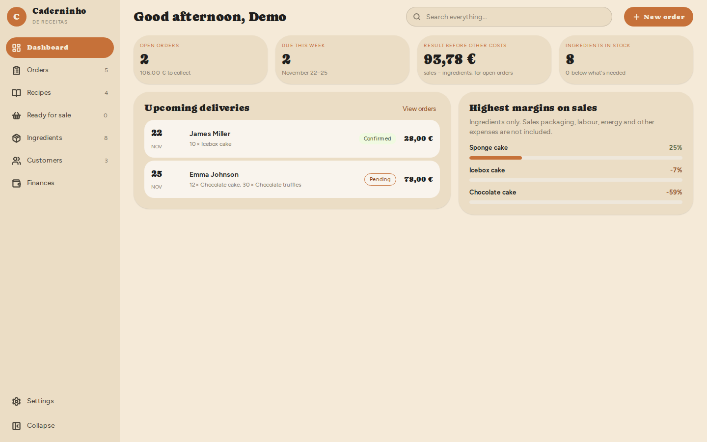
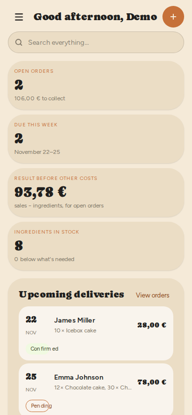
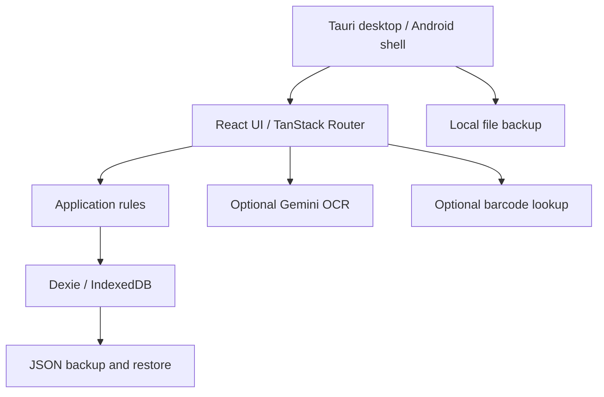

# Caderninho de Receitas 🍰

**A local-first workspace for small food businesses to price recipes, manage pantry stock, plan production and deliver customer orders.**

Built with React, TypeScript and Dexie, then packaged with Tauri for desktop and Android. The interface supports Portuguese and English. The separate [product site](https://luisfelipealves.github.io/caderninho-site/) introduces the app to customers; **this repository contains the application source code**.



| Desktop browser viewport | Mobile browser viewport |
| --- | --- |
|  |  |

*Captured from the current React build in automated Chromium viewports using the app's built-in sample data. The native Tauri shell is not shown. The product screenshots below come from the public site and may differ from the latest build.*

| Recipe costing | Orders |
| --- | --- |
|  |  |
| Financial overview | Home |
|  |  |

## What it does

- **Ingredients and purchasing:** package prices, pantry stock, barcode lookup, low-stock alerts and purchase history.
- **Recipes and pricing:** ingredient cost per batch and per serving, sales price, margin and markup. An unknown cost stays unknown rather than silently becoming zero.
- **Production and orders:** making a batch consumes pantry stock and adds ready-to-sell servings; delivery consumes finished servings. Insufficient stock blocks the entire transaction. Order reversal restores the servings actually deducted.
- **Customers and finances:** order status and PDF summaries, purchase/sales views, charts and CSV export.
- **Optional receipt reading:** Gemini extracts candidate purchase lines from a receipt image for human review before saving. Barcode lookup can query Open Food Facts.
- **Data portability:** JSON export/import; the Tauri app also writes daily local backups and can write a second copy to a user-selected folder.

The core database is local and requires no account or application server. Receipt images leave the device **only when the optional Gemini feature is used**; barcode lookup likewise calls an external service. A key embedded with `VITE_GEMINI_KEY` is exposed to the client, so use a restricted key or ask the user to supply one.

## Architecture



| Area | Where to look |
| --- | --- |
| Routes and navigation | `src/routes/`, `src/router.tsx`, `src/components/shell/` |
| Data model and schema migration | `src/lib/db.ts` |
| Cost, stock and delivery rules | `src/lib/receita-custo.ts`, `src/lib/operacional.ts`, `src/lib/producao.ts` |
| Receipt and barcode integrations | `src/lib/fatura-ocr.ts`, `src/lib/open-food-facts.ts` |
| Backup and restore | `src/lib/backup.ts`, `src/lib/backup-auto.ts` |
| Packaging and CI | `src-tauri/`, `.github/workflows/` |

A useful design decision is the separation of **reference package quantity** from **current pantry stock**. Production changes stock without changing the denominator used to calculate an ingredient's unit cost. Dexie transactions keep purchases, production, delivery and reversals consistent; versioned schema migrations preserve older local data. See [cost decisions](docs/fase-1-custos.md) and [operational integrity](docs/etapa-1.md).

## Run it locally

Install a supported Node.js version and [Bun](https://bun.sh/). The repository commits `bun.lock`.

```bash
git clone https://github.com/luisfelipealves/chef-inventario.git
cd chef-inventario
bun install --frozen-lockfile
bun run dev
```

Open the local address printed by Vite. The web build is useful for development; automatic file backups run only in Tauri. Receipt reading is optional. To configure it locally, copy `.env.example` to `.env` and set `VITE_GEMINI_KEY`, or enter a key in the application.

```bash
bun run typecheck
bun run lint
bun run test
bun run build
```

For a native desktop build, install Rust and the [Tauri platform prerequisites](https://v2.tauri.app/start/prerequisites/), then run `bun run tauri dev` or `bun run tauri build`. Android additionally needs Android Studio/SDK, NDK, Java and Rust Android targets; initialize once with `bun run tauri:android:init`, then use `bun run tauri:android:apk`. CI workflows cover Windows, macOS and Android packaging. Android release signing uses repository secrets and the same keystore across updates.

## How we developed it

I defined the product around real recipe-cost and stock workflows and reviewed the interface and behavior with AI assistance. We delivered in increments: first the local data model and costing, then customers and orders, mobile layouts, production history, finished stock and operational safeguards. Feedback from use led to a critical correction separating package pricing from pantry stock. We recorded decisions in `docs/`, covered business rules and migrations with Vitest and `fake-indexeddb`, and used type checks, lint, builds and CI before packaging. Product decisions and acceptance stayed with the human owner; AI helped implement and review bounded changes.

## Portfolio snapshot

**Focus:** offline-first product architecture, transactional business rules, data migration, optional AI integration and cross-platform packaging. **Stack:** React 19, TypeScript, TanStack Router, Dexie/IndexedDB, Vite, Tauri/Rust, Vitest and GitHub Actions.

This repository is currently **private**. Make it accessible before linking it in a public CV.
